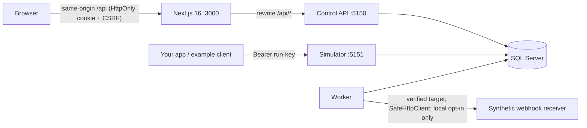
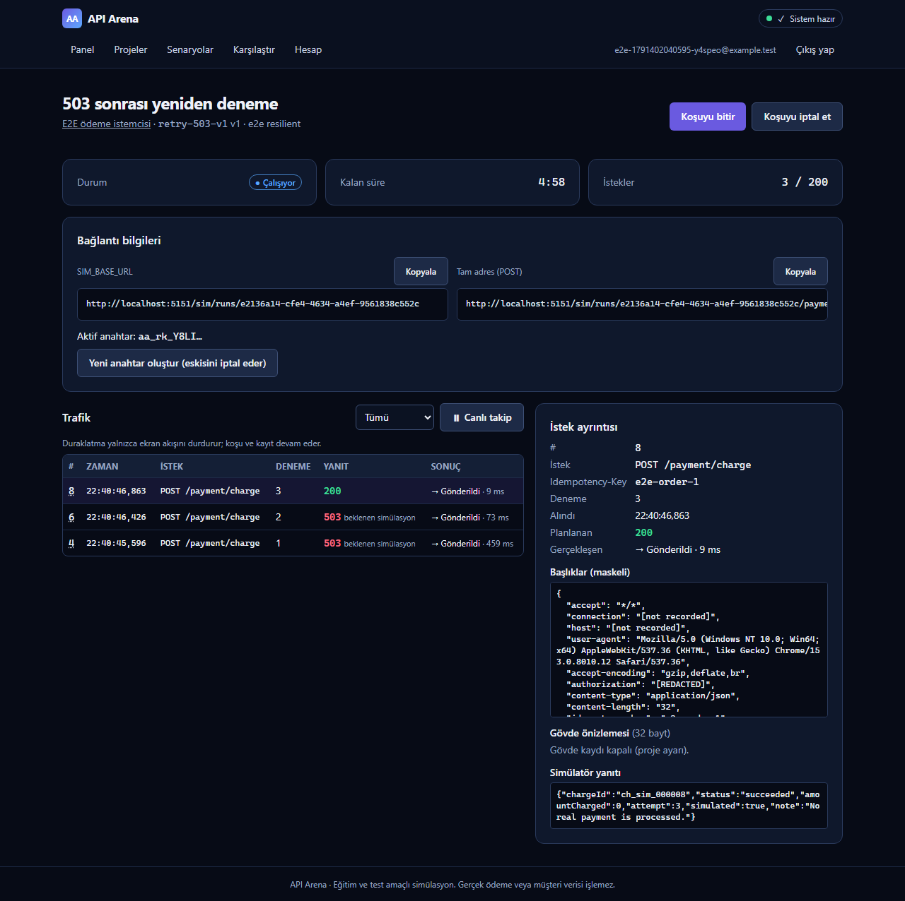
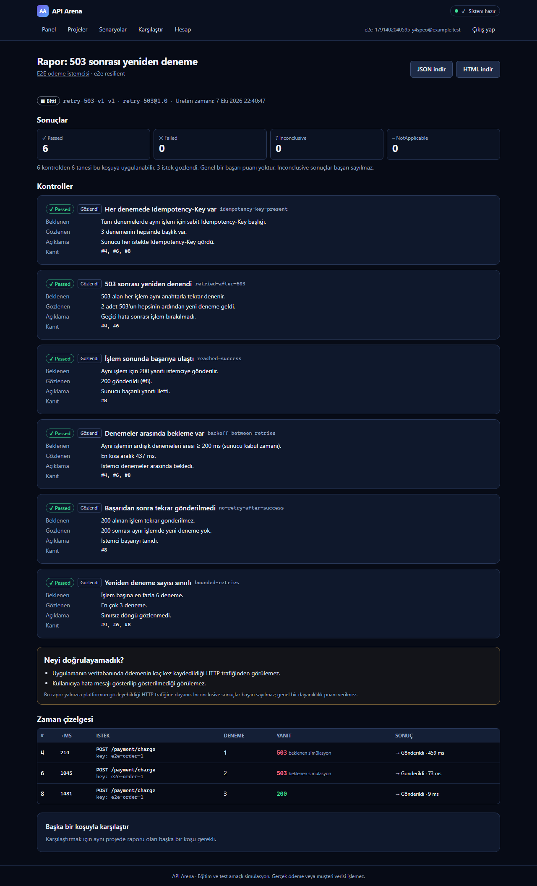

# API Arena

[](https://github.com/MertDas24/api-arena/actions/workflows/ci.yml)

Connect your application to **controlled API failure scenarios**, watch what it actually sends, and get an **evidence-based report** — then fix your client and compare the next run.

> Similar tools exist (Mockoon, WireMock, Webhook.site). API Arena's focus is a guided, explain-as-you-go flow for junior developers and small teams. This is a learning/portfolio project and a market hypothesis — no validated demand or revenue.

| Scenario | What the fake service does | What is evaluated (from server-observed HTTP only) |
|---|---|---|
| `retry-503-v1` | 1st and 2nd attempt of an operation → `503`, 3rd → `200` | Idempotency-Key present, retried after 503, reached success, backoff ≥ 200 ms, no retry after success, bounded retries |
| `rate-limit-v1` | first request → `429` + `Retry-After: 2`, then `200` | waited ≥ Retry-After (server receipt time, 100 ms tolerance), eventual success, no hammering |
| `timeout-v1` | 3 s delay, then `200` | client disconnected before the delay (transport evidence), within budget, bounded retries; *"showed a good error to the user"* is always **Inconclusive** |

Every check is `Passed`, `Failed`, `Inconclusive` or `NotApplicable`, with expected/observed values and evidence sequence numbers. There is **no overall score**; missing evidence is never counted as a pass.

## Architecture



.NET 10 LTS (ASP.NET Core minimal APIs, EF Core, Identity) · SQL Server · Next.js 16 / React 19 / TypeScript strict / Tailwind 4 · xUnit v3 · Vitest · Playwright. Details: [docs/ARCHITECTURE.md](docs/ARCHITECTURE.md), threat model: [docs/THREAT_MODEL.md](docs/THREAT_MODEL.md), decisions: [docs/DECISIONS.md](docs/DECISIONS.md).

## Quick start (local)

Prerequisites: .NET SDK 10.0.4xx (`global.json`), Node.js ≥ 22.12 (24 recommended) with npm, and SQL Server.

### Windows (native SQL Server, recommended on this project's dev machine)
Uses Windows authentication against `localhost` — no password needed.
```powershell
cd frontend; npm ci; cd ..
./scripts/dev.ps1            # applies migrations, opens API :5150, simulator :5151, worker and frontend :3000
```

### macOS (Intel) / Linux (Docker SQL Server)
```bash
./scripts/dev-secrets.sh     # writes a git-ignored .env with a locally generated SA password (never printed)
docker compose up -d         # SQL Server bound to 127.0.0.1:1433, named volume
./scripts/dev.sh             # migrate + start everything (Ctrl+C stops)
```
`docker compose down -v` **deletes all local data** (named volume). Apple Silicon: Microsoft does not support the SQL Server image on arm64; use a remote development SQL Server (see ADR-003). The Docker path was not verified on the author's machine (no Docker available).

Open http://localhost:3000, register, then open **Dev mailbox** (`/dev/mailbox`, development only) to follow the verification link — no real e-mail is sent locally.

### Demo data (explicit opt-in, development only)
```powershell
$env:APIARENA_DEMO_PASSWORD = [System.Net.NetworkCredential]::new("", (Read-Host -AsSecureString "Demo password (min 10 chars)")).Password   # PowerShell 5.1 + 7
$env:ASPNETCORE_ENVIRONMENT = "Development"                       # --seed-demo refuses to run outside Development
dotnet run --project backend/src/APIArena.Api -- --seed-demo      # creates demo@apiarena.local + "[DEMO]" project
./scripts/demo.ps1 -Scenario retry-503                           # real runs: naive vs resilient client, prints report links
```

## Tests
| Command | What |
|---|---|
| `./scripts/test.ps1` / `scripts/test.sh` | backend build + unit + integration (real SQL Server), frontend lint + typecheck + unit + build |
| `./scripts/e2e.ps1` / `scripts/e2e.sh` | Playwright against the real stack (DB `ApiArena_E2E`), incl. 360/390/768/1440 px overflow and axe checks |
| `scripts/security-scan.sh` | .NET + npm dependency scan, gitleaks |
| `./scripts/load-test.ps1` | bounded loopback load + real SQL, CPU/RAM/p95/polling/worker contention |
| `./scripts/migration-job-smoke.ps1` | explicit migration job twice against fresh disposable SQL DB |
| `./scripts/restore-drill.ps1` | checksum backup→new DB restore→CHECKDB→migration/data checks |

Integration tests create and drop a uniquely named database per run (`APIARENA_TEST_SQL` overrides the server connection).

## Configuration
All settings come from `appsettings*.json` and environment variables (`ApiArena__Section__Key`). See [.env.example](.env.example) for names (no values). Production refuses to start with unsafe settings (localhost URLs, `TrustServerCertificate=true`, file mail sink, webhooks without attested egress restriction, demo seeding).

---

## Türkçe kullanım

1. **Kayıt ol** ve e-postanı doğrula (yerelde `/dev/mailbox`). Doğrulanmamış hesaplar koşu başlatamaz.
2. **Proje oluştur** — aynı uygulamanın koşularını bir arada tutar.
3. **Yeni koşu** sihirbazı: senaryoyu seç → erişim anahtarı oluştur (**bir kez gösterilir**, maskelidir) → testi başlat.
4. Uygulamana `SIM_BASE_URL` ve `RUN_KEY` ortam değişkenlerini ver; anahtarı koda, URL'ye veya komut geçmişine yazma. Hazır istemci: [examples/dotnet-client](examples/dotnet-client/README.md).
5. **Canlı ekranda** istekleri izle. Beklenen 503/429 yanıtları "beklenen simülasyon" olarak, platform reddi ayrı olarak işaretlenir.
6. **Koşuyu bitir** → kanıta dayalı rapor; "Neyi doğrulayamadık?" bölümünü oku, öneriyi uygula, yeni koşu başlat, **karşılaştır**.

Limitler (varsayılan): kullanıcı başına 3 aktif koşu, 24 saatte 30 koşu, koşu başına 200 istek, koşu süresi 5 dk, gövde 64 KiB. Bunlar platform limitidir; test sonucu değildir.

## Status and limitations
See [docs/STATUS.md](docs/STATUS.md) and [docs/RELEASE_CHECKLIST.md](docs/RELEASE_CHECKLIST.md). Notable: no public deployment has been made; HTTP evidence cannot prove what your database did; outbound webhooks are disabled by default.

## License
[MIT](LICENSE), chosen by Mert on 2026-10-07. This does not certify legal compliance or remove technical release gates.

## Feature status

| Feature | Current evidence/status |
|---|---|
| Three core scenarios, accounts, reports, comparison, exports | Locally verified MVP |
| Duplicate/out-of-order webhooks + sample receiver | Local opt-in demo and SQL tests; public profile forces webhooks off |
| Custom declarative scenarios | Editor UI (server preview = simulator semantics, import/export, versions) + backend tests + E2E |
| Read-only sharing, automatic retention | Implemented and tested locally (sanitised, noindex, expiring/revocable links; leased bounded cleanup job) |
| Metrics / alerts | Low-cardinality APIArena meter tested; **no exporter/monitoring receiver wired, so no alerts are active** ([operations runbook](docs/runbooks/OPERATIONS.md)) |
| Production containers/TLS proxy/controlled migration | Config and runbook prepared; Docker/hosting path unverified |
| Billing/teams/subscriptions | Out of scope |

Portfolio v1 code/test gates pass locally; final release is **blocked only by external access** (Docker/hosting/TLS, remote CI, GitHub private reporting, production egress, monitoring receiver). Current checks: 94 backend unit, 145 SQL integration, 29 frontend unit and 8 Playwright tests (9 screens × 4 widths plus editor/share/webhook screens with axe). [Load sample and assumptions](docs/LOAD_TEST.md) do not establish hosting capacity or prices.

## Demo walkthrough

Prepare a verified local account/project, then run `./scripts/demo.ps1 -Scenario retry-503`: the naive client stops at 503; the resilient client sends 503 → 503 → 200 with one operation key and backoff. Open both reports and compare evidence. Repeat with `rate-limit` and `timeout` (see example client README). Local webhook setup: [docs/WEBHOOKS.md](docs/WEBHOOKS.md). Synthetic events are not real payments; adapter results are `AdapterReported`.

## Threat model summary

Control-plane cookie sessions require CSRF and ownership checks; simulator calls use independent revocable run keys. User content is text, observations are bounded/masked, missing evidence stays Inconclusive. Outbound calls use DNS/IP validation and connection pinning; public webhook use additionally requires enforced network egress. Production Identity keys require an external private certificate. Remaining risks and unverified infrastructure: [release gates](docs/RELEASE_CHECKLIST.md), [security review](docs/SECURITY_REVIEW.md).

## Real screenshots

Captured from the actual local Playwright flow (2026-10-07), using synthetic `example.test` accounts/payment data and masked Authorization. No generated success figures.




## Production preparation

[Deployment/rollback runbook](docs/runbooks/DEPLOYMENT.md) describes `infra/compose.production.yml`: non-root multi-stage images, separate TLS hostnames, private DB/SMTP network, read-only external secrets, health and resource limits. Explicit job: `docker compose -f infra/compose.production.yml --profile migration run --rm migrate`. Blocked gates must pass before publication; no public deployment is claimed. [Portfolio/demo narrative](PORTFOLIO.md), [Mert's architecture notes](docs/MERT_ARCHITECTURE.md).
