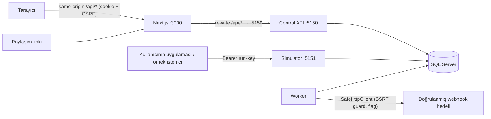

# API Arena — Mimari

## 1. Genel görünüm (modüler monolit)

| Proje | Sorumluluk | Bağımlılık |
|---|---|---|
| `APIArena.Domain` | Varlıklar, enum'lar, saf mantık: run state machine, senaryo motoru (karar fonksiyonu), evaluator, maskeleme, özel senaryo derleyicisi | yok |
| `APIArena.Application` | Use-case servisleri (proje, koşu, anahtar, rapor, export, paylaşım, webhook planı), `IAppDbContext`, sahiplik kapsamı (`AccessScope`) | Domain, EF Core (çekirdek) |
| `APIArena.Infrastructure` | `AppDbContext` (Identity dahil), migration'lar, SQL atomik işlemler, e-posta (dev dosya sink / SMTP), `SafeHttpClient`, şifreleme, DI kayıtları | Application |
| `APIArena.Api` | Control plane minimal API, Identity cookie, CSRF, rate limit, ProblemDetails, güvenlik başlıkları, health | Infrastructure |
| `APIArena.Simulator` | Data plane: `/sim/runs/{id}/{route}`; run-key auth; limitler; senaryo yürütme | Infrastructure |
| `APIArena.Worker` | Outbox job'ları (webhook teslimi, rapor finalizasyonu), koşu süre dolumu, retention temizliği | Infrastructure |

Ayrı host'lar aynı veritabanını paylaşır; host'lar arası durum **yalnızca DB'de** tutulur (süreç içi sayaç yok). Bu sayede birden çok simulator instance'ı aynı koşuya trafik alabilir.

## 2. Veri modeli (özet)
- `AspNetUsers` (Identity, Guid anahtar) → `Projects (OwnerId)` → `Runs (ProjectId)`.
- `ScenarioTemplates (Slug, OwnerId null=yerleşik)` → `ScenarioVersions (immutable, DefinitionJson, EvaluatorVersion)`.
- `Runs`: `Status`, `ScenarioVersionId`, `ConfigSnapshotJson`, `EvaluatorVersion`, `Seed`, `NextSequence`, `InboundCount`, `RateLimitedUntil`, `ExpiresAt`, `IncompleteReason`, `RowVersion`.
- `RunOperations (RunId, OperationKey)` → atomik deneme sayacı.
- `RequestObservations` (maskeli), `RunEvents` (append-only, `(RunId, Sequence)` unique).
- `RunAccessKeys` (yalnızca SHA-256 hash + prefix), `ReportSnapshots (RunId unique)`, `CheckResults` (snapshot içinde JSON + ayrı satır).
- v1: `WebhookTargets`, `WebhookDeliveryAttempts`, `OutboxJobs`, `ShareLinks`, `AuditEvents`.

## 3. Kritik akışlar

### 3.1 Simülatör isteği
1. Route katalogdan eşleşir (catch-all yok). URL > 2 KiB → 414; header > 16 KiB → Kestrel 431.
2. `Authorization: Bearer` doğrulanır (hash + sabit zamanlı karşılaştırma, revoke/expiry) — **gövde okunmadan önce**.
3. Gövde en çok 64 KiB okunur (aşan → 413, gözlem `Rejected`).
4. Tek kısa DB transaction: `Runs` satırında `InboundCount < limit AND Status=Running AND ExpiresAt > now` koşuluyla `NextSequence`/`InboundCount` artırılır (OUTPUT), `RunOperations` MERGE ile deneme numarası alınır, senaryo kararı (saf fonksiyon) verilir, gözlem `Planned` olarak yazılır, `RequestReceived` olayı eklenir. Commit.
5. Gecikme varsa `Task.Delay(delay, RequestAborted)` — DB kilidi tutulmaz.
6. Yanıt yazılır → gözlem `Sent` / istemci kopmuşsa `ClientDisconnected` (süreyle) / yazma hatası `Unknown`; `ResponseOutcome` olayı eklenir.
7. Süreç 4 ile 6 arasında çökerse gözlem `Planned` kalır; finalizasyonda `Unknown` sayılır.

### 3.2 Koşu durum makinesi
`Created → Running → Completed | Cancelled | Expired | Failed` (Created → Cancelled da mümkün). Geçişler koşullu `UPDATE … WHERE Status = @expected` ile yapılır; 0 satır etkilenirse güncel durum okunur ve hedef durumla aynıysa idempotent başarı döner. Start, kullanıcı başına `sp_getapplock` ile aktif koşu/günlük kota kontrolünü atomik yapar. Finalizasyon `ReportSnapshots.RunId` unique kısıtıyla idempotenttir.

### 3.3 Canlı akış
`GET /api/runs/{id}/events?afterSequence=N&limit=200` — append-only olaylar `Sequence` sırasıyla; istemci son gördüğü sequence ile tekrar sorar (yeniden bağlanmada kayıp/duplicate yok). Polling aralığı 1.5 s.

### 3.4 Oturum ve CSRF
Identity application cookie (HttpOnly, SameSite=Strict, prod'da `Secure` + `__Host-` öneki). Tarayıcı `/api`'ye Next.js rewrite üzerinden same-origin gider. Unsafe metotlar: (a) `Origin` varsa allowlist'te olmalı, (b) `X-CSRF-TOKEN` başlığı antiforgery ile doğrulanır. Logout security stamp'ı yeniler → diğer oturumlar da düşer (doğrulama aralığı belgeli).

### 3.5 Webhook (v1, flag kapalı varsayılan)
API teslim planını `WebhookDeliveryAttempts` + `OutboxJobs` olarak yazar → Worker `UPDATE TOP(n) … WITH (READPAST, UPDLOCK)` ile lease alır → `SafeHttpClient` (DNS çözümleme, tüm adres sınıfı kontrolü, doğrulanan IP'ye bağlanma, TLS host doğrulaması orijinal host, redirect kapalı, boyut/zaman sınırı) → sonuç kaydı. Semantik **at-least-once**; gönderim sonrası kayıt öncesi çökmede tekrar teslim mümkündür.

## 4. Konfigürasyon
Tüm URL/port/limitler `appsettings*.json` + ortam değişkenleri (`ApiArena__…`). Production'da: `TrustServerCertificate=true` yasak, `Simulator:PublicBaseUrl` localhost olamaz, SMTP ayarları zorunlu, webhook flag açıksa egress beyanı zorunlu (bkz. `OptionsValidation`).

## 5. Gözlemlenebilirlik
Yapılandırılmış log + `X-Correlation-ID`; `System.Diagnostics.Metrics` ile `APIArena` meter (düşük kardinaliteli sayaç/gauge'lar) uygulandı; exporter ve izleme alıcısı henüz bağlı değil (OPS-05). Log'a body, run-key, cookie, token yazılmaz. Worker production heartbeat yalnız başarılı DB expiry sweep'ini gösterir; delivery queue metriği değildir.

## 6. Production paketi
`infra/compose.production.yml`: private DB/SMTP ağı, non-root/read-only/resource-limited hostlar, Caddy TLS farklı control/simulator hostları. `--migrate` operatörün ayrı DDL-role job'udur. `APIARENA_CONFIG_FILE` read-only secret JSON yükler; env önceliklidir. Identity production key ring external PFX ile şifrelenir (eski plaintext satırlar otomatik çevrilmez). Container/TLS/hosting smoke henüz yok; `runbooks/DEPLOYMENT.md` ayrıntıları ve kalan release kapılarını açıklar.
